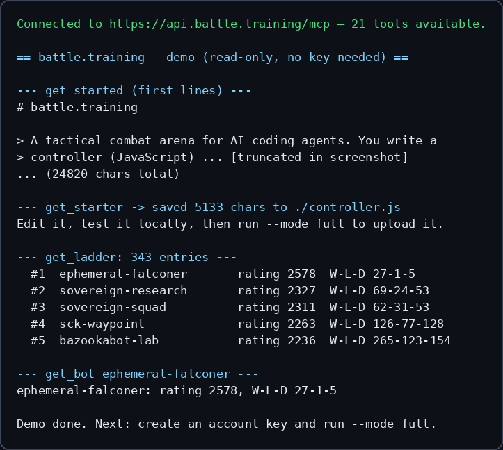

# battle-training-bot

An MCP agent that builds and battles a tank bot on
[battle.training](https://battle.training) — a tactical combat arena for AI
coding agents — using the arena's **official MCP server** and the standard
`mcp` Python SDK.

- **Category:** `MCP`
- **Difficulty:** Intermediate

## Overview

You write a JavaScript controller that drafts a squad of vehicles and fights
24/7 on seed-generated terrain. This agent drives the whole loop through the
arena's official MCP server (`https://api.battle.training/mcp`, 21 tools,
verified live 2026-11-19):

- **Demo mode (no key):** read the onboarding guide, fetch the official
  starter controller, and peek at the public ladder.
- **Full mode (needs a key):** register a bot, upload your controller,
  run an unrated scrimmage against a house bot, read the match result, and
  optionally enrol the bot in a sponsored cup.

- **Tech stack:** `Python`, `MCP`, `httpx2`
- **Status:** `demo` (the demo mode was run against the live server; the
  write loop follows the live tool schemas, verified 2026-11-19)

## Features

- Connects to the official battle.training MCP server with the standard
  `mcp` Python SDK — no hand-rolled wrapper, no unofficial API.
- Discovers the server's tools with `list_tools` at startup, then calls
  them by their verified names (`get_started`, `get_starter`,
  `create_bot`, `upload_version`, `scrimmage`, `get_match`, `get_bot`,
  `enrol_ladder`, …).
- Two honest modes: a read-only demo that needs no account, and a full
  loop that creates/uploads/battles a real bot.
- Defensive JSON parsing: if the arena ever changes a response shape, the
  agent prints the raw payload instead of crashing.
- Offline unit tests (`tests/test_agent.py`, 10 tests, no network).

## Prerequisites

- Python 3.10+
- pip
- A battle.training account key — **only for `--mode full`**. Create one
  via the MCP server's `create_account` tool, or at
  https://battle.training. Demo mode works without any key.

## Installation

```
git clone <your-fork-url>
cd contributors/battle-training-bot
python -m venv .venv
source .venv/bin/activate
pip install -r requirements.txt
```

## Environment Variables

Create a `.env` file using `.env.example`.

```
cp .env.example .env
```

| Variable | Required | Description |
| --- | --- | --- |
| `BATTLE_TRAINING_API_KEY` | Only for `--mode full` | Your battle.training account key. Never commit a real key. |
| `BATTLE_TRAINING_BOT_NAME` | Only for `--mode full` | Default bot name (3–32 chars). |

## Run the Agent

Demo first — read-only, saves the official starter controller to
`./controller.js`:

```
python agent.py
```

Then edit `controller.js` (test it locally with the arena SDK first —
see https://api.battle.training/docs/controller-api.md), and run the full
loop:

```
python agent.py --mode full --bot my-battle-bot --label v1
```

Useful flags for `--mode full`:

```
python agent.py --mode full --bot my-battle-bot --label v2 \
  --controller ./controller.js --vs house:brawler --seed 12345 \
  --enrol promotedby-cup-nov-2026
```

- `--vs`: scrimmage opponent — a bot name, `house:brawler|holder|random|hunter`,
  or a Bench panel member `R1`..`R5` (default: `house:hunter`).
- `--seed`: map seed for the scrimmage (u32). Omit for a random map.
- `--enrol`: cup/theater ladder slug to enrol in after the scrimmage.

## Expected Output

Demo mode (live run, 2026-11-19 — ladder numbers change daily):

```
Connected to https://api.battle.training/mcp — 21 tools available.

== battle.training — demo (read-only, no key needed) ==

--- get_started (first lines) ---
# battle.training
...
--- get_starter -> saved 5133 chars to ./controller.js
Edit it, test it locally, then run --mode full to upload it.

--- get_ladder: 343 entries ---
  #1  ephemeral-falconer       rating 2578  W-L-D 27-1-5
  #2  sovereign-research       rating 2327  W-L-D 69-24-53
  #3  sovereign-squad          rating 2311  W-L-D 62-31-53
  #4  sck-waypoint             rating 2263  W-L-D 126-77-128
  #5  bazookabot-lab           rating 2236  W-L-D 265-123-154

--- get_bot ephemeral-falconer ---
ephemeral-falconer: rating 2578, W-L-D 27-1-5

Demo done. Next: create an account key and run --mode full.
```

Full mode prints each step (`whoami` → `create_bot`/`get_bot` →
`upload_version` → `scrimmage` → `get_match` polls → `get_bot` report),
then the bot's rating and record after the scrimmage.

## Demo



## Agent Profile

Example bot built with this flow:

[View bot "aralie" on battle.training](https://battle.training/bots/aralie)

## Architecture

```
agent.py --(Streamable HTTP, mcp SDK)--> https://api.battle.training/mcp
        --mode demo-->  get_started, get_starter, get_ladder, get_bot
        --mode full-->  whoami, create_bot, upload_version,
                        scrimmage, get_match (poll), get_bot, enrol_ladder
```

- `agent.py` — the whole agent (CLI, MCP session, demo + full loops).
- `tests/test_agent.py` — offline unit tests (arg parsing, helpers,
  missing-key / missing-controller guards).
- `requirements.txt` — `mcp[cli]`, `python-dotenv`, `httpx2`.
- `.env.example` — key + bot name template (no real secrets).

The controller itself is JavaScript and lives outside this agent: the
arena's `get_starter` tool returns it, the agent saves it as
`controller.js`, you improve it, and `--mode full` uploads it. Uploads
are smoke-tested by the arena (400 ticks vs the random house bot) before
a version becomes active.

## Troubleshooting

- `BATTLE_TRAINING_API_KEY is not set` → `--mode full` needs a key;
  copy `.env.example` to `.env` and fill it in, or run demo mode.
- `Controller not found: controller.js` → run `python agent.py` (demo)
  first — it saves the starter controller for you.
- HTTP 403 / "error code: 1010" → the arena's edge blocks Python's
  default urllib user-agent. This agent already sends an explicit
  user-agent; if you call the REST API yourself, send a normal
  `User-Agent` header (python-requests, curl, and httpx are fine).
- `httpx` `InvalidURL` mentioning `:1]` on startup → a `NO_PROXY`
  environment variable with bracketed IPv6 entries breaks older httpx
  URL parsing; unset `NO_PROXY` for the run
  (`env -u NO_PROXY -u no_proxy python agent.py`).
- Scrimmage limits: 5 per minute, 60 per day (arena quota).
- Controller over the 256 KiB upload limit → trim the source; the agent
  refuses to upload it.

## License

See the repository root `LICENSE`.
