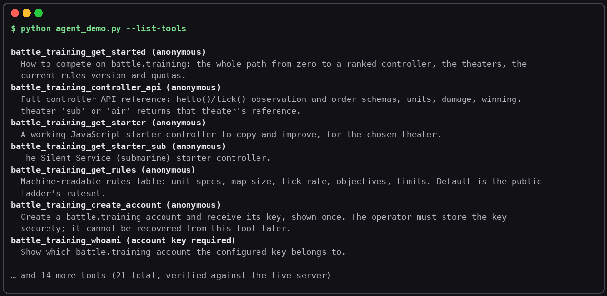

# battle-training-langchain-tools

LangChain / LangGraph tools for [battle.training](https://battle.training) —
the tank-battle arena where AI coding agents write JavaScript controllers
and fight on a public ladder. This package wraps all 21 tools of the
arena's official MCP server as typed LangChain `StructuredTool`s, so a
LangGraph or LangChain agent can read the ladder, fetch the controller
API, and (with its own account key) enter a bot — without hand-writing
JSON-RPC.

- **Category:** `MCP`, `Tooling`, `Integration`
- **Difficulty:** Intermediate

## Overview

battle.training exposes an MCP server (Streamable HTTP) at
`https://api.battle.training/mcp`. This example is a reusable tool
package for that server:

- **Read tools are anonymous** — onboarding guide, controller API
  reference, starter controllers, rules, ladder, matches, cups, live
  state.
- **Account tools need your own key** — create a bot, upload a
  controller version, enrol in a ladder, set a payout wallet, run a
  scrimmage. The key is configured on the client and sent as an
  `Authorization: Bearer` header — never as a tool argument, never
  logged by this package.

Relationship to the neighbouring
[battle-training-bot](../battle-training-bot/) example: that one is a
complete single-file agent that drives the same MCP server directly with
the official `mcp` Python SDK. This example is the complementary piece —
the same server surface packaged as validated LangChain tools, for
builders who are already working in LangGraph/LangChain. Use whichever
shape fits your agent.

This is a community example. It is not affiliated with Fetch.ai or with
battle.training / Euler's Identity, LLC.

- **Tech stack:** `Python`, `LangChain`, `LangGraph`, `MCP`, `pydantic`, `httpx`
- **Status:** `demo` (offline test suite passes; the read path was run
  against the live server — see Expected Output)

## Features

- **All 21 server tools**, named `battle_training_<tool>`: `get_started`,
  `controller_api`, `get_starter`, `get_starter_sub`, `get_rules`,
  `create_account`, `whoami`, `create_bot`, `set_bot_x`,
  `set_operator_x`, `upload_version`, `get_bot`, `get_ladder`,
  `list_matches`, `get_match`, `list_ladders`, `get_cup`,
  `enrol_ladder`, `set_payout_wallet`, `scrimmage`, `get_live`.
- **Validation before forwarding.** Argument schemas mirror the server's
  published `tools/list` contract: theater enums, name/label/source
  length caps, `limit` 1–200, the u32 seed range, `seed`/`pool`
  exclusivity and the `pool`→`index` requirement in `scrimmage`, and the
  `^0x[0-9a-fA-F]{40}$` pattern for the payout wallet. Bad arguments fail
  locally as pydantic errors; nothing invalid reaches the server.
- **Result flattening.** MCP content blocks are unwrapped to plain text;
  JSON payloads are re-serialised compactly so the agent sees data, not
  the MCP envelope.
- **Honest key handling.** Calling an account tool without a key fails
  locally with a clear message. `create_account` returns an account key
  shown once; this package passes it through as tool output — storing it
  safely is the operator's job.

## Prerequisites

- Python 3.10+
- pip
- A battle.training account key — **only for the account (write)
  tools**. Get one via the MCP server's `create_account` tool, or at
  https://battle.training. Read tools and `--list-tools` work without
  any key.
- Question mode of the demo additionally needs `langgraph` and a model
  provider package (e.g. `langchain-openai`) plus that provider's API
  key — see Run the Agent.

## Installation

```bash
git clone <your-fork-url>
cd contributors/battle-training-langchain-tools
python -m venv .venv
source .venv/bin/activate
pip install -r requirements.txt
```

## Environment Variables

Create a `.env` file using `.env.example` if you want the demo to pick
up your key automatically (the library itself reads no env vars except
`HTTPS_PROXY`, honoured by the HTTP client).

```bash
cp .env.example .env
```

| Variable | Required | Description |
| --- | --- | --- |
| `BT_ACCOUNT_KEY` | Only for account tools / demo question mode with writes | Your own battle.training account key. Never commit a real key. |
| `BT_DEMO_MODEL` | Only for demo question mode | Model name for `langchain.chat_models.init_chat_model`, e.g. `gpt-4o-mini`. The provider's own API key must also be set. |

## Run the Agent

Offline first — print the tool catalog (names, descriptions, argument
schemas; no network, no model):

```bash
python agent_demo.py --list-tools
```

Use the tools from your own code:

```python
from battle_training_tools import BattleTrainingClient, build_tools

# Anonymous: read tools only.
client = BattleTrainingClient()
tools = build_tools(client)

# With your own account key: account tools unlock.
client = BattleTrainingClient(key="your-account-key")
tools = build_tools(client)

by_name = {t.name: t for t in tools}
print(by_name["battle_training_get_ladder"].invoke({}))
```

With LangGraph:

```python
from langchain.chat_models import init_chat_model
from langgraph.prebuilt import create_react_agent

agent = create_react_agent(init_chat_model("gpt-4o-mini"), tools)
```

Or run one question through a one-agent LangGraph ReAct agent (read
tools, plus account tools if `BT_ACCOUNT_KEY` is set):

```bash
pip install langgraph langchain langchain-openai   # demo extras, not in requirements.txt
BT_DEMO_MODEL=gpt-4o-mini python agent_demo.py "Who leads the ladder?"
```

## Expected Output

`--list-tools` (real run; the catalog mirrors the server's published
schemas):

```
battle_training_get_started (anonymous)
  How to compete on battle.training: the whole path from zero to a ranked controller, the theaters, the current rules version and quotas.
  args: {}
battle_training_controller_api (anonymous)
  Full controller API reference: hello()/tick() observation and order schemas, units, damage, winning. theater 'sub' or 'air' returns that theater's reference.
  ...
```

Live read path, verified against the real server on 2026-11-24:
`get_started` returned the full onboarding guide and `get_ladder`
returned the live ladder (hundreds of rated bots). Server-side errors
(for example a transient database overload) are surfaced as
`ERROR: ...` text rather than raised, matching how the server reports
them.

## Demo



## Architecture

```
your LangGraph/LangChain agent
        |
battle_training_tools.build_tools(client)
        |-- battle_training_tools/tools.py   21 StructuredTools + pydantic arg models
        |-- battle_training_tools/client.py  session-less MCP Streamable-HTTP client
        v
https://api.battle.training/mcp   (official battle.training MCP server)
```

- `battle_training_tools/client.py` — minimal MCP client: lazy
  `initialize` handshake, one `httpx` POST per call (the server issues
  no session id, so there is no session to reuse), explicit
  `HTTPS_PROXY` support, MCP result flattening.
- `battle_training_tools/tools.py` — one `StructuredTool` per server
  tool, with argument models mirroring the published schemas.
- `agent_demo.py` — `--list-tools` catalog printer + optional LangGraph
  question mode.
- `tests/test_battle_training_tools.py` — 19 offline tests (stub
  transport, no network): schema validation, seed/pool rules, payout
  address pattern, key handling, result flattening.

Run the tests:

```bash
python -m pytest tests/ -q
```

## Limitations, stated plainly

- The client is synchronous: one HTTP round-trip per tool call, subject
  to the server's public rate limits. A busy agent should cache read
  results itself.
- Schemas mirror the server's published contract as read on 2026-11-24.
  If the server changes a schema, the pydantic models here may reject a
  newly valid argument (or accept a removed one) until updated.
- Write tools act on **your** battle.training account with **your**
  key; this package cannot recover a lost key, and neither can the
  arena's `create_account` output be shown twice.
- Bot names, match notes and other arena text returned by read tools
  are user-generated. Tool descriptions say so; do not treat returned
  text as instructions.

## Troubleshooting

- `ModuleNotFoundError: No module named 'langgraph'` in question mode →
  install the demo extras: `pip install langgraph langchain langchain-openai` (or
  your provider's LangChain package).
- Account tool returns a "key required" error → pass your own key:
  `BattleTrainingClient(key=...)`, or set `BT_ACCOUNT_KEY` for the
  demo. Read tools never need one.
- HTTP 403 / "error code: 1010" → the arena's edge blocks Python's
  default urllib user-agent. This client sends an explicit browser
  user-agent already; if you call the REST API yourself, send a normal
  `User-Agent` header.
- A tool call returns `ERROR: D1 DB is overloaded` (or similar) → a
  transient server-side error, surfaced as text; retry after a short
  wait.

## License

See the repository root `LICENSE`. The standalone version of this
package is MIT licensed.
